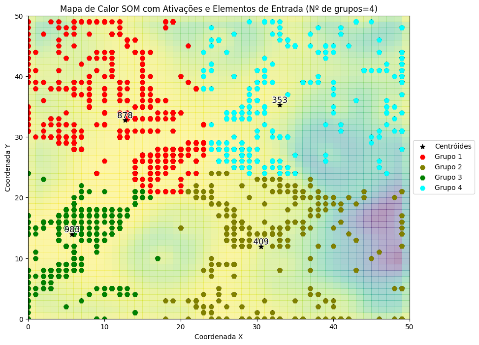
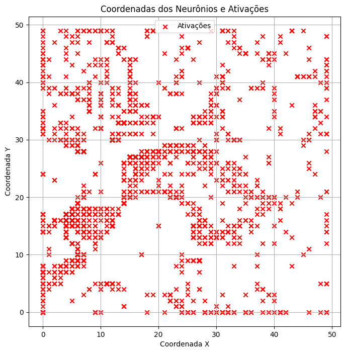
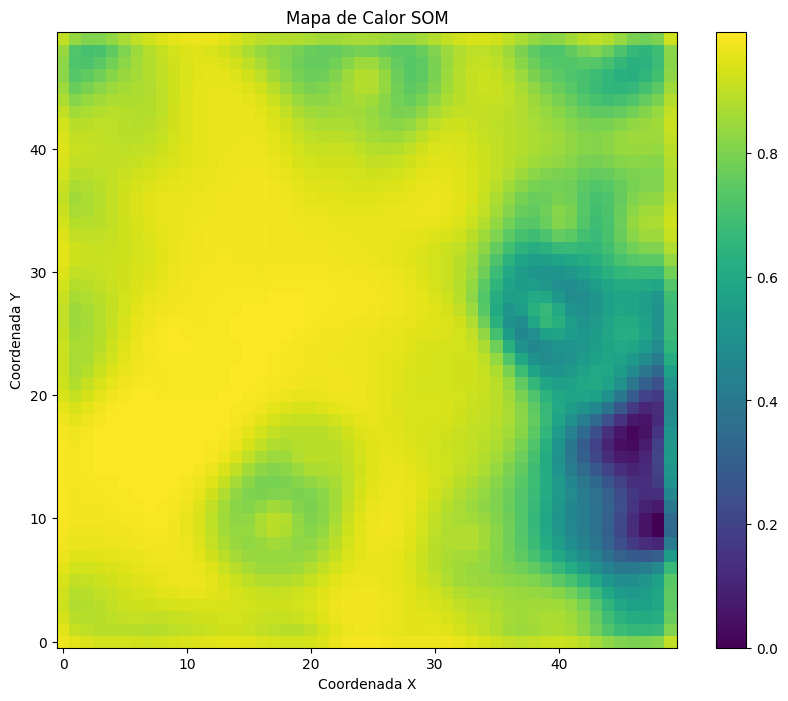
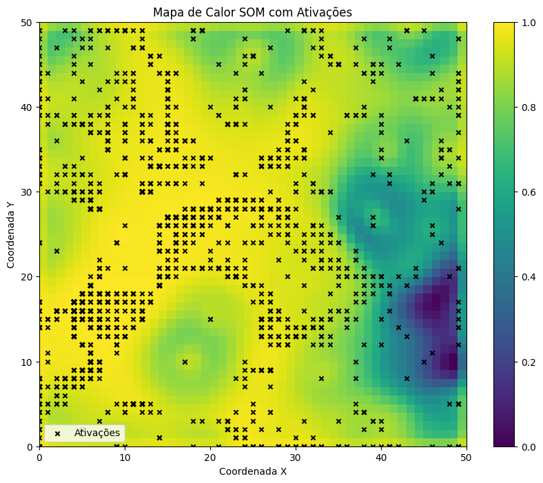
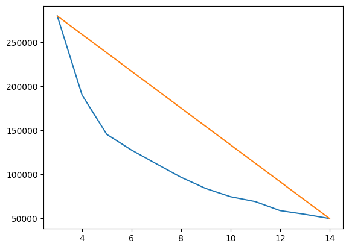
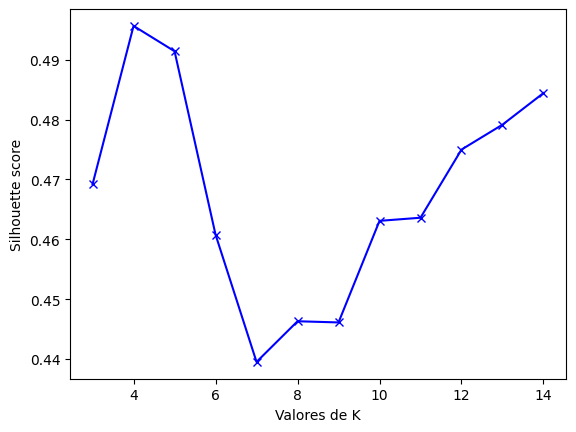
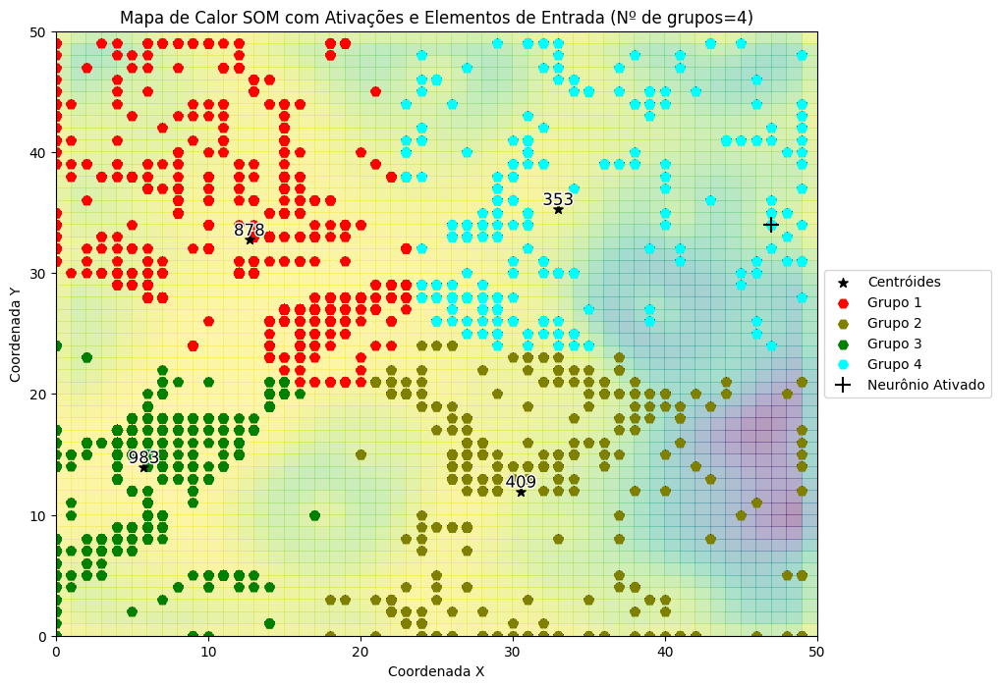

# Taxpayer Segmentation with Self-Organizing Maps

Unsupervised clustering of taxpayers registered in state active debt (*dívida ativa*), built as a Computational Intelligence project with data provided by the PGE (*Procuradoria-Geral do Estado*). The goal is to group debtors with similar profiles so collection strategies can be prioritized per group instead of treating every debtor the same way.



## Highlights

- **About 1M raw records → 2,623 taxpayer profiles.** Debt records were cleaned, encoded and aggregated into one row per taxpayer, with about 120 numeric features.
- **50×50 Self-Organizing Map** with a final **quantization error of 0.08**, picked after comparing four grid and hyperparameter setups.
- **4 taxpayer groups**, picked by both the elbow method and the Silhouette Score (best K, about 0.50). The groups hold **878, 409, 983 and 353** taxpayers.
- **Taxpayer lookup:** given a taxpayer's code, the model returns their group, so the segmentation can be used on individual cases.

## Why a SOM?

The data has no labels: nobody knows ahead of time what the "right" groups of debtors are. The features are also high-dimensional (about 120) and sparse, since most of them come from one-hot encoding. Distances in that kind of space are noisy and hard to interpret.

A Self-Organizing Map is a neural network that learns a 2D grid of prototypes. It places similar taxpayers on nearby neurons and keeps the topology of the original space. Clustering the SOM output instead of the raw features gives:

- a low-dimensional space for K-Means, and
- a **visual map** of the data (the U-Matrix), where boundaries between profiles are visible before any clustering runs.

## Data

- About 1M records with 45 columns: debt status, collection phase and sphere, installment plans, lawsuits, protests, revenue and billed amounts per fiscal year, and several key dates.
- Personal and identifying fields (taxpayer code, company name, CPF/CNPJ, partners, accountant, address) arrive **already anonymized**.
- The dataset is not public and is **not included** in this repository. The published notebook has its outputs cleared.

## Pipeline

### 1. Data preparation

- **Cleaning** (rules validated with the PGE stakeholders)
  - `"-"` treated as null
  - drop suspended debts and records without fiscal year or debt type
  - drop write-off (*baixado*) taxpayers with no debt status
  - fill missing installment fields with sensible defaults
  - assert that each taxpayer code maps to a single CPF/CNPJ
- **Transformation:** decimal-comma strings to floats, text normalization, dates parsed and converted to Unix timestamps.
- **Encoding:** binary mapping for yes/no style features, one-hot encoding for the other categoricals.
- **Feature engineering:** yearly revenue (*arrecadado*) and billed (*faturado*) amounts are pivoted into one column per year.
- **Aggregation:** records are rolled up to one row per taxpayer.
- **Normalization:** `MinMaxScaler` to [0, 1].

About 500k records remain after cleaning; aggregation turns them into 2,623 taxpayer profiles.

### 2. Self-Organizing Map

Trained with [MiniSom](https://github.com/JustGlowing/minisom). Several grid sizes and hyperparameters were compared:

| Config | Grid | Learning rate | Sigma | Iterations | Resulting K |
|---|---|---|---|---|---|
| Best spread | 15×15 | 0.65 | 5 | 200 | 9 |
| Densest | 30×30 | 0.65 | 1 | 200 | 11 |
| Optimized | 100×100 | 0.65 | 5 | 500 | 11 |
| **Final** | **50×50** | **0.57** | **9** | **5000** | **4** |

The earlier setups trained for few iterations and produced fragmented clusterings (K = 9 to 11). The final map has a wider neighborhood (sigma = 9) and trains 10 to 25 times longer, which produced a smoother map with 4 well-separated groups.

**Where each taxpayer lands.** Every × is the best-matching neuron of at least one taxpayer. Dense areas and empty corridors already hint at the groups:



**U-Matrix.** The heatmap shows how similar each neuron is to its neighbors (plotted as `1 - distance`). Yellow areas are homogeneous regions; darker areas are borders between different profiles. The dark region on the right marks the most distinct part of the data.



Overlaying the activations on the U-Matrix shows where the taxpayers sit relative to those regions and borders:



### 3. Choosing the number of groups

K-Means runs on the coordinates of the winning neurons for K = 3 to 14, and two independent criteria pick K.

| Elbow method | Silhouette Score |
|---|---|
|  |  |

- **Elbow:** the point of maximum distance between the WCSS curve and the line joining its ends gives **K = 4**.
- **Silhouette:** the score peaks at **K = 4** (about 0.50) and drops sharply after K = 5.

### 4. Final clusters

With K = 4, each group occupies a contiguous region of the map. The numbers on the centroids are group sizes:

| Group | Taxpayers | Share |
|---|---|---|
| 1 | 878 | 33% |
| 2 | 409 | 16% |
| 3 | 983 | 37% |
| 4 | 353 | 13% |


### 5. Classifying a taxpayer

Given an (anonymized) taxpayer code, the notebook finds that taxpayer's winning neuron on the trained SOM and assigns it to the nearest K-Means centroid:

```
Digite o código do contribuinte: <anonymized code>
O neurônio ativado pertence ao grupo 4
```

The cross marks the neuron activated by the looked-up taxpayer:



## What was achieved

- **Raw operational data turned into a modeling dataset.** About 1M inconsistent records became a clean, normalized profile per taxpayer, using cleaning rules agreed with the domain experts.
- **Structure found without labels.** The SOM revealed distinct regions in the data, and two independent metrics agreed on 4 groups.
- **The result is usable, not just a chart.** Any taxpayer can be placed in a group from their code.

## Next steps

- Profile each group by its feature averages (debt amount, installments, lawsuits, collection phase) and give each one a meaningful name.
- Validate the groups with the collection team against real collection outcomes.
- Package the lookup as a small service or function instead of an interactive notebook cell.

## Tech stack

Python · pandas · NumPy · scikit-learn (K-Means, MinMaxScaler, silhouette score) · MiniSom · Matplotlib · Google Colab / Google Drive

## Running

1. Open `taxpayer-segmentation-som.ipynb` in Google Colab.
2. Point the `read_csv` / `to_csv` paths, currently under `/content/drive/Shareddrives/IA grupo 7/`, to your own copy of the data.
3. Run all cells. The first cell installs `minisom` and mounts Google Drive.

To run locally instead:

```bash
pip install pandas numpy matplotlib scikit-learn minisom jupyter
```

Then remove the `google.colab` import and the `drive.mount` call.

## Repository structure

```
.
├── taxpayer-segmentation-som.ipynb   # full pipeline: preparation, SOM, clustering, lookup
├── images/                           # result charts used in this README
└── README.md
```

The last section of the notebook, *Códigos de exemplo*, holds earlier experiments: DBSCAN, a MiniSom example on the UCI Seeds dataset, and K-Means on a toy dataset.

*Chart titles and labels are in Portuguese, as in the original notebook.*
